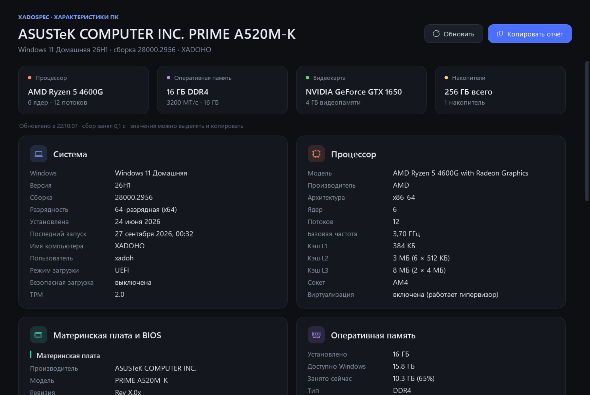
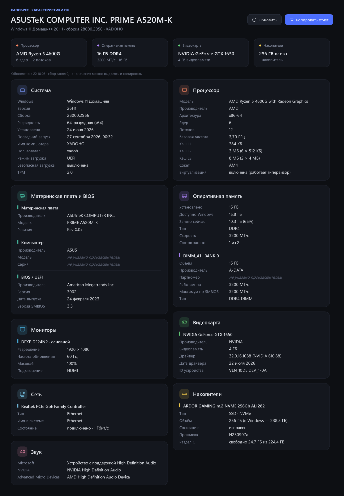
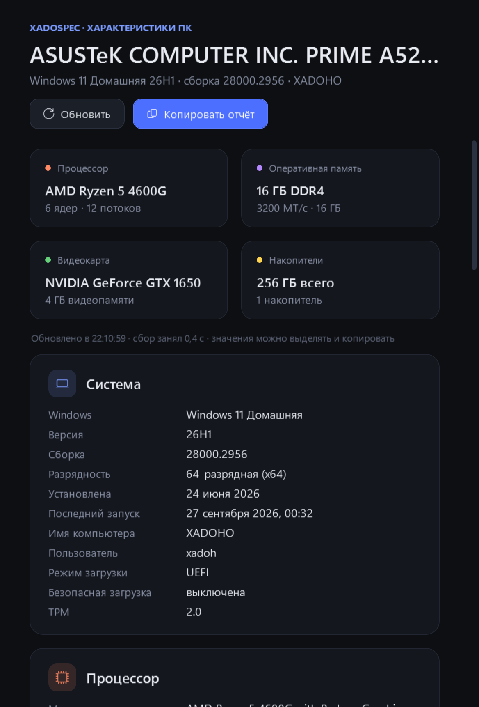

# XadoSpec

Лёгкое приложение для Windows, которое показывает характеристики компьютера: систему, процессор, материнскую плату, оперативную память, видеокарту, мониторы, накопители, сеть и звук.

Главное — точность. Каждая цифра берётся из самого надёжного источника, а не из первого попавшегося поля WMI: видеопамять не обрезается на 4 ГБ, частота монитора показывается до сотых, а заглушки из прошивки вроде «To be filled by O.E.M.» не выдаются за данные.

**[Скачать XadoSpec.exe](https://github.com/xadoho/XadoSpec/releases/latest)** · Windows 10 и 11 · ~100 КБ, установка не нужна · Канал: [t.me/xadohot](https://t.me/xadohot)



<p>
  
  
</p>

## Возможности

- **Один файл ~100 КБ.** Без установки и без отдельных рантаймов: нужный .NET Framework 4.8 уже встроен в Windows 10 (1903 и новее) и Windows 11.
- **Быстро.** Разделы собираются параллельно, обычно за доли секунды.
- **Сводка сверху**: процессор, память, видеокарта и накопители — коротко, в четырёх плитках.
- **Девять разделов**:
  - **Система** — выпуск и версия Windows, сборка, разрядность, дата установки, последний запуск, режим загрузки (UEFI / Legacy), безопасная загрузка, TPM, батарея у ноутбуков.
  - **Процессор** — модель, ядра и потоки (у гибридных — отдельно производительные и энергоэффективные ядра), базовая частота, кэш L1–L3 с разбивкой, сокет, виртуализация.
  - **Материнская плата и BIOS** — производитель, модель, ревизия, модель компьютера, версия и дата BIOS, версия SMBIOS.
  - **Оперативная память** — установлено и доступно Windows, занято сейчас, тип, рабочая скорость, занятые слоты и каждая планка: объём, производитель, партномер, скорость.
  - **Видеокарта** — видеопамять, версия и дата драйвера, ID устройства.
  - **Мониторы** — модель, разрешение, частота обновления, масштаб, разъём, основной монитор.
  - **Накопители** — модель, тип (NVMe / SATA, SSD / HDD), объём, исправность, прошивка, свободное место на разделах.
  - **Сеть** — физические адаптеры, тип, состояние и скорость подключения.
  - **Звук** — звуковые устройства.
- **Любое значение выделяется и копируется**, а кнопка «Копировать отчёт» кладёт в буфер все характеристики текстом — удобно для форума, сервиса или объявления о продаже.
- Тёмная тема, тёмный заголовок окна, две колонки на широком окне и одна на узком. F5 — обновить.
- Работает **без прав администратора**, ничего не отправляет в сеть и ничего не записывает на диск.

## Точность

| Что | Откуда | Почему так |
|---|---|---|
| Выпуск Windows | `Win32_OperatingSystem`, версия и номер обновления — из реестра (`DisplayVersion`, `UBR`) | В реестре `ProductName` у Windows 11 до сих пор «Windows 10», поэтому он не используется |
| Ядра, потоки, кэш | `GetLogicalProcessorInformationEx` — тот же источник, что у Диспетчера задач | Видит классы ядер у гибридных процессоров и каждый экземпляр кэша |
| Установленная память | `GetPhysicallyInstalledSystemMemory` | Ровно то, что Windows пишет в «Установленная ОЗУ»; сколько доступно системе, показано отдельно |
| Скорость памяти | `ConfiguredClockSpeed` из SMBIOS | Реальная рабочая скорость (с XMP / EXPO), паспортная показана отдельно |
| Производитель памяти | SMBIOS, коды JEDEC переводятся в названия | Многие платы отдают «80CE» вместо «Samsung» |
| Видеопамять | `HardwareInformation.qwMemorySize` из ключа драйвера | Стандартное поле `AdapterRAM` 32-битное и обрезает всё, что больше 4 ГБ |
| Драйвер видеокарты | Версия драйвера Windows | Для NVIDIA пересчитывается в привычный вид (32.0.15.6094 → 560.94), для AMD добавляется версия Adrenalin |
| Мониторы | `QueryDisplayConfig`, имя — из EDID | Дробная частота, как в Параметрах (59,94 Гц, 143,98 Гц), масштаб у каждого монитора свой |
| Накопители | `MSFT_PhysicalDisk` (Storage API) | Тип шины и носителя, исправность; объём сразу в двух видах — «как на коробке» (1 ТБ) и «как в Windows» (931,5 ГБ) |
| TPM | `Tbsi_GetDeviceInfo` | Версия TPM без прав администратора |
| Сеть | `MSFT_NetAdapter`, только физические адаптеры | Без виртуальных адаптеров VPN, Hyper-V и Bluetooth |

Пустые поля и заглушки из прошивки («To be filled by O.E.M.», «Default string», «System Product Name») показываются серым как «не указано производителем». Если значение определить не удалось, так и написано — угаданных значений приложение не подставляет.

Значения на скриншотах сверены с независимыми запросами к Windows (`Get-CimInstance`, `Get-PhysicalDisk`).

## Установка

Скачайте `XadoSpec-1.0.0.exe` со страницы [Releases](https://github.com/xadoho/XadoSpec/releases/latest) и запустите.

Файл не подписан сертификатом, поэтому при первом запуске Windows может показать окно SmartScreen «Система Windows защитила ваш компьютер». Нажмите «Подробнее» → «Выполнить в любом случае».

Нужна Windows 10 версии 1903 или новее либо Windows 11.

## Командная строка

```
XadoSpec.exe --dump report.txt
```

Сохраняет полный отчёт в текстовый файл, не открывая окно.

## Сборка из исходников

Нужен .NET SDK 6 или новее. Справочные сборки .NET Framework 4.8 подтянутся из NuGet сами.

```bash
git clone https://github.com/xadoho/XadoSpec.git
cd XadoSpec
dotnet build -c Release
```

Готовый файл — `bin/Release/net48/XadoSpec.exe`.

```
Collector.cs    сбор данных: WMI, SMBIOS, Windows API, реестр
Native.cs       объявления функций Windows
Model.cs        разделы, строки, текстовый отчёт
MainWindow.cs   интерфейс
Program.cs      запуск, тема, ключи командной строки
```

## Лицензия

[MIT](LICENSE).

---

Автор — Xadoho · [t.me/xadohot](https://t.me/xadohot)
